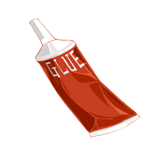
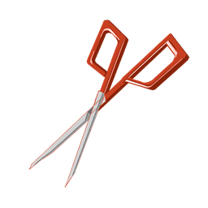

# DMX-Alice — The show goes on backstage

**You failed the audition.** The audience snickers. The spotlight moves on.  
But a play is not only what happens downstage. Long before the curtain rises, another stage is already alive — **backstage**.

Ideas flee. Some are useful; some are just noise. Props must be made. The set must land on cue.  
You may not stand in the lights — but you can hold the night together.

---

## About

*DMX-Alice* is a short narrative experience about joining a school musical crew after a failed acting audition.  
The new show is **Moonlit Tryst** — a meeting at the treeline, a token at the table. Your job is to catch what fits, clear what doesn’t, and build the night.

- **Story-led** — dialogue with Sam, Roxy, and the crew  
- **Brainstorm** — separate useful thoughts from noise  
- **Prop making** — craft with tools  
- **Stage dressing** — place the scene to the rhythm of the show  

---

## Tools of the trade

|  |  |  |  |
|:---:|:---:|:---:|:---:|
| Brush | Clue | Paint | Scissors |

---

## Chapters

**01 · Brainstorm**  
An ice-breaker teaches the rule: ideas come fast; keep what’s worth keeping.  
Clear dark interference, pick the right answer under a timer, then catch keyword thoughts that can hold *Moonlit Tryst* — castle, candlelight, long table, parchment…

**02 · Prop Making**  
Turn ideas into objects. Drag tools. Finish what the stage needs.

**03 · Set Dressing**  
Moonlight, leaves, table, token — place them where the scene can breathe.

**04 · Ending**  
Someone else takes the bow. You left the bones of the night.

---

## Controls

- **Left click** — advance dialogue, choose options, clear noise, catch keywords, drag tools / props  
- **Choice rounds** — stationary buttons; clear dark cards first when they cover answers  
- **Keyword round** — click floating thoughts (keep the helpful ones)  

Best played around **1920×1080** landscape.

---

## Details

- **Length** — a short session  
- **Platform** — Windows download  
- **Engine** — Unity 2022.3  
- **Status** — student / class project  

---

*Thank you for playing. The curtain rises either way.*
